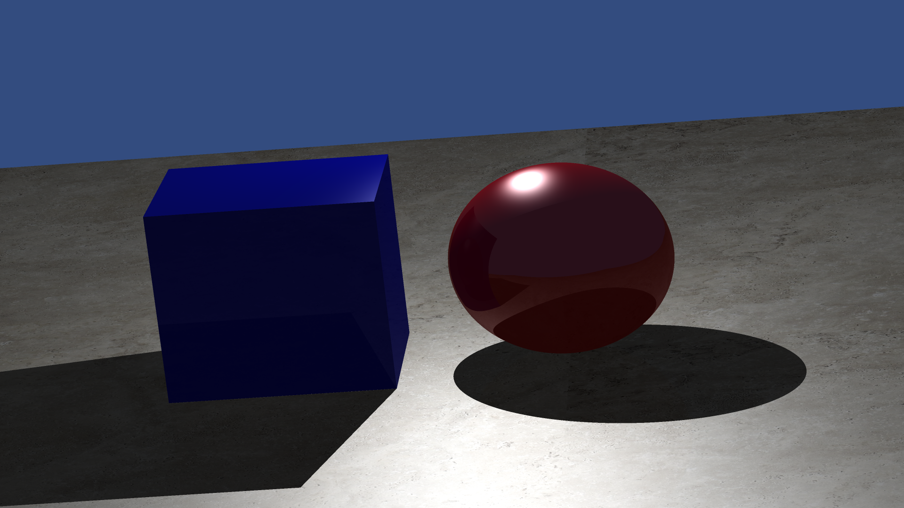

# Whitted Ray Tracer

A C++17 CPU renderer built for the University of Edinburgh Computer Graphics coursework. It traces camera, shadow and reflection rays through a scene of analytic primitives, with optional distributed sampling for soft shadows, glossy reflections, depth of field and camera motion blur.

[中文说明](README.zh-CN.md) · [Render gallery](docs/gallery.md) · [Implementation notes](docs/architecture.md)



## Features

| Area | Implementation |
| --- | --- |
| Camera | Perspective ray generation from Blender camera parameters |
| Geometry | Spheres, rotated uniformly scaled cubes, finite quadrilateral planes |
| Shading | Ambient term, diffuse lighting, Blinn–Phong specular highlights |
| Visibility | Shadow rays, recursive mirror reflections |
| Acceleration | Longest-axis median-split BVH with AABB traversal; switchable linear traversal |
| Surface detail | Repeating plane UVs and 8-bit P3/P6 PPM textures (max value 255) |
| Sampling | Square-grid supersampling, disk-sampled soft shadows, perturbed reflection directions |
| Camera effects | Lens sampling for depth of field; temporal camera translation for motion blur |
| Scene workflow | Blender export script and a supplied JSON scene |

The renderer uses only the C++ standard library. Blender is optional; the supplied scene renders without it. Python and Pillow are only needed for image conversion, and the smoke tests use Python's standard library.

## Build and run

Use a C++17 compiler and Make, or CMake 3.16+.

```bash
make
./build/ray --width 640 --height 360 --output output/base.ppm
```

Run commands from the repository root so the default scene and texture paths resolve. The output directory is created automatically. Omitting the resolution overrides uses the supplied scene's 1920 × 1080 camera settings.

Alternatively:

```bash
cmake -S . -B build -DCMAKE_BUILD_TYPE=Release
cmake --build build --parallel
./build/ray --help
```

The default render enables BVH traversal, recursive reflections and four samples per pixel. Soft shadows, glossy reflections, depth of field and motion blur start disabled.

To convert an output to PNG:

```bash
python3 -m pip install Pillow
python3 scripts/convert_image.py output/base.ppm output/base.png
```

## Try the effects

```bash
# Antialiasing: one sample versus a 3 × 3 grid
./build/ray --no-aa --output output/aa_off.ppm
./build/ray --aa --samples 9 --output output/aa_on.ppm

# Soft shadows from samples around each point light
./build/ray --softshadow --shadow-samples 16 --light-radius 0.5 \
  --output output/soft_shadows.ppm

# Glossy reflections
./build/ray --glossy --glossy-samples 4 --glossy-spread 0.12 \
  --output output/glossy.ppm

# Camera effects with multiple samples
./build/ray --aa --samples 9 --dof --aperture 0.05 --focus-dist 36 \
  --output output/dof.ppm
./build/ray --aa --samples 9 --motionblur --motion-amount 0.5 \
  --output output/motion_blur.ppm

# Compare traversal or disable recursive reflections
./build/ray --no-bvh --output output/linear.ppm
./build/ray --no-refl --output output/no_reflections.ppm
```

`--samples` must be a positive perfect square, such as 1, 4, 9 or 16. Depth of field and motion blur need multiple camera samples to produce blur; use `--aa --samples 4` or higher. Motion blur models lateral camera movement through a static scene.

Render a 640 × 360 set of comparisons with:

```bash
python3 scripts/render_examples.py
# Or generate only one example
python3 scripts/render_examples.py --only shadow_soft
```

Use `--scene path/to/scene.json`, `--texture path/to/texture.ppm`, `--width`, `--height` and `--output` to override the inputs and output. All flags are listed by `--help`.

## Repository layout

```text
src/                    C++ renderer, geometry, math and image I/O
scenes/demo.json        Supplied Blender-exported scene
assets/stone.ppm         Supplied texture, stored as binary P6
blender/                Original scene and portable export script
scripts/                Example rendering and image conversion
tests/                  Render, traversal and CLI regression checks
docs/                   Architecture notes and original render gallery
.github/workflows/      Linux and macOS build/test workflow
```

## Blender workflow

Open `blender/demo.blend`, load `blender/export_scene.py` in Blender's Text Editor and run it. The script writes `demo.json` next to the saved blend file. Pass that path to the renderer:

```bash
./build/ray --scene blender/demo.json --output output/blender_scene.ppm
```

Meshes are identified by names containing `Sphere`, `Cube` or `Plane`; point lights and cameras are exported. The scene loader expects the exporter's four-space pretty-printed format. It is a small coursework parser, so arbitrary JSON formatting, general meshes and imported materials are outside its current scope. Blender's exported depth-of-field metadata is not consumed; use the renderer's CLI controls.

## Validation

```bash
python3 tests/smoke_test.py build/ray
```

The checks render a small scene, validate the PPM payload, compare BVH and linear output, exercise reflection and effect toggles, and verify error handling. The GitHub Actions workflow runs the build and these checks on Linux and macOS.

## Project history and scope

This repository packages the final integrated coursework renderer rather than the intermediate labs. The gallery contains the original coursework PNGs; the texture's pixels are preserved while its storage changes from ASCII P3 to binary P6. Packaging also adds portable paths, build configuration, repeatable checks and small CLI/I/O fixes.

This is a single-threaded educational Whitted renderer. Shadow queries remain linear, planes also receive a direct intersection pass, glossy sampling is applied only to the first reflection, and materials are defined in the primitive classes. See the [implementation notes](docs/architecture.md) for those trade-offs.
