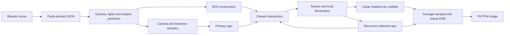

# Implementation notes

## Rendering pipeline

## Source map

| File | Responsibility |
| --- | --- |
| `raytracer.cpp` | CLI configuration, lighting, recursive tracing and sample accumulation |
| `camera.cpp`, `rotation.h` | Perspective rays and Euler XYZ rotation |
| `sphere.h`, `cube.h`, `plane.h` | Primitive intersections, materials and bounds |
| `bvh.h`, `aabb.h` | Median-split hierarchy and slab tests |
| `scene_loader.cpp` | Exporter-format camera, light and geometry loading |
| `image.cpp` | P3/P6 texture reading and P6 output |
| `vec3.h`, `ray.h`, `hit.h` | Vector operations, rays and intersection records |

## Acceleration

The BVH chooses the longest axis of the combined bounding box, partitions primitive centres at the median, and recursively creates one primitive per leaf. Traversal rejects boxes beyond the nearest recorded hit. `--no-bvh` provides a linear reference traversal.

Planes are present in the BVH and receive an additional direct intersection pass. This preserves the original handling of thin plane bounds and UVs. Shadow rays still iterate through objects directly; the project does not claim that all visibility queries are accelerated. The supplied scene has only three objects, so its gallery is not a BVH performance benchmark.

## Sampling and shading

The renderer averages an N × N subpixel grid. Soft shadows sample virtual positions on a disk around a point light. Glossy reflections perturb the reflected direction, only at the first reflection bounce to bound the cost. Reflection recursion ends after the fixed depth limit.

Depth of field samples lens positions and aims rays at a point along the corresponding pinhole direction at the chosen focus distance. Camera motion blur translates the camera along its right vector over deterministic time samples. The sampling sequence is reproducible and intentionally simple; it can show structured noise or ghosting at low sample counts.

Diffuse and specular material properties are defined in the primitive classes. Light intensity includes coursework-specific scale factors, and RGB is clamped directly; this is not a physically based, colour-managed renderer.

## Scene format

The loader reads the pretty-printed schema emitted by `blender/export_scene.py`, including camera parameters, point lights and supported primitive transforms. It depends on line layout and field order. Preserve `json.dump(..., indent=4)` when generating a scene.

Only a single camera is intended. Cube and sphere scaling is uniform, and finite planes use four exported vertices. Blender material settings and exported DOF metadata are not applied. Camera-effect parameters are provided through the CLI.

## Packaging changes

The original final coursework sources remain in the source workspace. This copy makes input paths and render dimensions configurable, validates CLI values, honours the reflection toggle, checks image reads/writes, and creates output directories. It adds Make/CMake dependency tracking, smoke checks, CI configuration and example scripts.

The supplied stone texture was converted losslessly from P3 to P6, reducing storage without changing the pixels. The PNG gallery preserves the pixels from the original final coursework outputs with image metadata removed, so it records the original renders rather than the packaging validation run.
