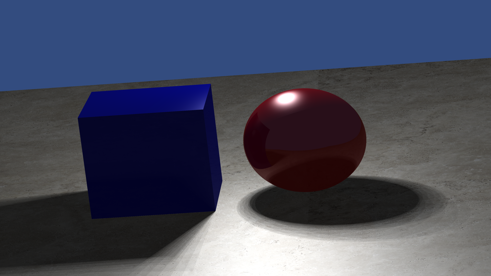
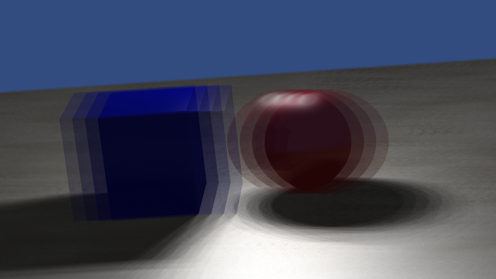

# Original render gallery

These PNGs preserve the final coursework render pixels with image metadata removed. They show the renderer's original effect comparisons at 1920 × 1080. Exact historical CLI settings were not saved with every image; the example commands in the README demonstrate the corresponding features without claiming pixel-identical reproduction.

## Antialiasing

| Disabled | Enabled |
| --- | --- |
|  |  |

## Shadows

| Hard shadows | Soft shadows |
| --- | --- |
|  |  |

## Reflections

| Mirror | Glossy |
| --- | --- |
|  |  |

## Depth of field

| Disabled | Enabled |
| --- | --- |
|  |  |

## Camera motion blur

| Disabled | Enabled |
| --- | --- |
|  |  |

## Combined effects

